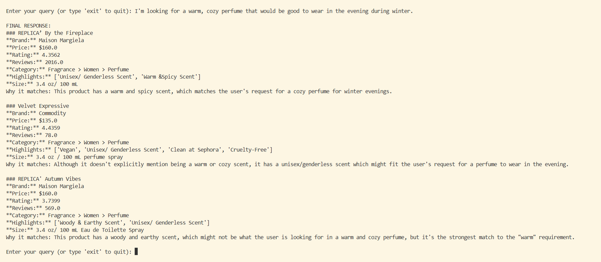
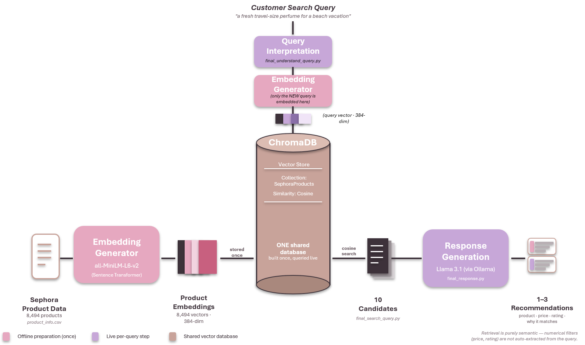

# Semantic Product Search

A local product recommendation system built with Sentence Transformers, ChromaDB and Llama 3.1 (via Ollama).

You describe what you want in plain language, for example *"a warm, cozy perfume for winter evenings"*. The system searches 8,494 Sephora products by semantic similarity and recommends the 1–3 best matches, explaining each one using the product data.


-black)


<p align="center">
  
</p>

---

## Why

Most online store search is keyword-based, so a request like *"fresh, elegant, and good for summer"* can miss products described as *"citrus, clean, light"*. This project looks at how vector databases and retrieval-augmented generation (RAG) can handle these kinds of requests, and where they still struggle.

Built as an independent study in information systems (INSY 661). The full write-up is in [`docs/report.pdf`](docs/report.pdf).

## How it works

<p align="center">
  
</p>

| Stage | What happens | Code |
|---|---|---|
| **Offline: build once** | Clean the Kaggle Sephora dataset, combine name, brand, category path, highlights, ingredients and variation into one text field, embed each product (384-dim), and store vectors plus price/rating/review metadata in ChromaDB (cosine distance) | [`scripts/`](scripts) |
| **1. Interpret** | Llama 3.1 extracts the descriptive intent from the request as structured JSON (Pydantic schema), without inventing preferences the user didn't state | [`understand_query.py`](recommender/understand_query.py) |
| **2. Retrieve** | The query is embedded with the same model, and ChromaDB returns the 10 nearest products, with optional `$lte`/`$gte` metadata filters | [`search.py`](recommender/search.py) |
| **3. Generate** | Llama 3.1 picks the 1–3 strongest candidates and explains each match, grounded only in the retrieved data | [`response.py`](recommender/response.py) |

Everything runs locally, so no API keys are needed.

## Quick start

**Prerequisites:** Python 3.11+ and [Ollama](https://ollama.com/download).

```bash
# 1. Clone and install
git clone https://github.com/SuryaJadeEdakunni/semantic-product-search.git
cd semantic-product-search
python -m venv .venv
source .venv/bin/activate          # Windows: .venv\Scripts\Activate.ps1
pip install -r requirements.txt

# 2. Get the local LLM (~4.9 GB)
ollama pull llama3.1

# 3. Get the vector database (pick one)
#    a) Download chroma_db.zip from the Releases page and unzip it into the project root
#    b) Or rebuild it from the raw data (~a few minutes):
python scripts/build_dataset.py
python scripts/build_index.py

# 4. Run
python main.py
```

```
Enter your query (or type 'exit' to quit): I want a fresh travel-size perfume for a beach vacation
```

The first run is slower while the embedding model downloads and Llama loads into memory. For detailed Windows/macOS setup and troubleshooting, see [`docs/SETUP.md`](docs/SETUP.md).

## What I found

Some results from testing (more detail in the report):

- **Queries combining several ideas worked well.** *"Fresh travel-size perfume for women for a beach vacation"* returned Crescent Beach Perfume Travel Spray as the top match.
- **Good matches usually came from overlapping language.** *"Woody earthy scented perfume"* returned a product whose highlights include *Woody & Earthy Scent*.
- **Semantic similarity doesn't enforce product category.** *"Something cheap that smells expensive"* returned perfumes, but also a deodorant and a candle.
- **The LLM invented numbers when asked to extract filters.** Early versions turned *"highly rated"* into a made-up 4.5 rating cutoff, so the final version only uses the LLM for the descriptive part of the query.
- **Relevant doesn't mean suitable.** *"Won't irritate sensitive skin"* returned reasonable products, but the data can't confirm that claim, so the response prompt doesn't allow unsupported medical or safety claims.
- **Smaller models weren't reliable enough.** Qwen 0.6B and 4B were tested for query parsing and either struggled with structured output or invented thresholds.

## Limitations & next steps

- **Explicit numeric constraints aren't applied automatically yet.** `search_products()` supports price, rating and review filters, but the CLI doesn't parse *"under $40"* into one. A rule-based extractor for explicit numbers is the natural next step.
- **A metadata value of 0 is ambiguous.** It can mean "no reviews" or "missing", because ChromaDB metadata can't store nulls.
- **Text-only.** Multimodal (image + text) embeddings would support visual shopping queries.
- **No formal evaluation set yet.** A labelled query set with precision@k would turn the qualitative testing into measurable results.

## Repository structure

```
semantic-product-search/
├── main.py                  # Interactive CLI: runs the 3-stage pipeline
├── recommender/
│   ├── config.py            # Paths, model names, settings
│   ├── understand_query.py  # Stage 1: LLM query interpretation
│   ├── search.py            # Stage 2: embedding + ChromaDB retrieval
│   └── response.py          # Stage 3: grounded LLM recommendations
├── scripts/
│   ├── build_dataset.py     # Download, clean and embed the product data
│   └── build_index.py       # Load embeddings + metadata into ChromaDB
├── experiments/             # Development scripts used while testing each stage
└── docs/
    ├── report.pdf           # Full research report
    ├── tutorial.pdf         # Step-by-step tutorial for building this system
    ├── presentation.pdf     # Project presentation
    └── SETUP.md             # Detailed setup & troubleshooting
```

> The report refers to the original file names (`FINAL.PY`, `final_understand_query.py`, `final_search_query.py`, `final_response.py`). These map to `main.py` and the three modules in `recommender/`.

## Data

[Sephora Products and Skincare Reviews](https://www.kaggle.com/datasets/nadyinky/sephora-products-and-skincare-reviews) on Kaggle (`product_info.csv`, 8,494 products). The raw data isn't redistributed here; `scripts/build_dataset.py` downloads it via `kagglehub`.

## Author

**Surya Jade Edakunni**: [LinkedIn](https://www.linkedin.com/in/suryaedakunni/) · [Portfolio](https://suryajadeedakunni.github.io)

Independent study supervised by Prof. Animesh Animesh.

## License

Code is released under the [MIT License](LICENSE). The report, tutorial and presentation in `docs/` are © Surya Jade Edakunni. Product data belongs to its original source.
